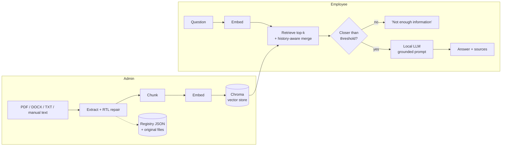

# Suhail — private, offline Arabic assistant for internal documents

[](https://github.com/ahmed17717/suhail/actions/workflows/ci.yml)


Suhail (Arabic for _Canopus_, the guide star) lets employees ask questions in Arabic about
their organisation's own documents and get answers **grounded in those documents, with
citations** — running entirely on a local server, with no data leaving the network.

It was built as a freelance project for an organisation that needed a private assistant
over internal policies and records. This repository is the cleaned-up, generic version:
no client data, no client branding.

## Highlights

- **Fully on-premise.** Local LLM (Qwen2.5-14B via `llama.cpp`) and local embeddings. No API
  calls, no telemetry, no CDN fonts — safe for an air-gapped network.
- **Grounded answers with sources.** Every answer lists the document and page it came from.
  If the documents don't contain the answer, the bot says so instead of guessing.
- **Arabic-first ingestion.** Repairs PDFs that store Arabic in visual (mirrored) order,
  and chunks punctuation-light legal/administrative text without cutting facts in half.
- **Admin panel** to upload PDF / Word / text files, add or edit manual entries, and delete
  documents — plus a CLI for bulk loading and re-indexing.
- **Safe by default.** Scrypt-hashed admin password, login throttling, fail-closed admin,
  upload validation, no user input ever reaches a file path.
- **Tested.** 130+ tests (no GPU or model download needed), linted and formatted in CI.

## How it works



A longer walkthrough, including the design trade-offs, is in
[`docs/ARCHITECTURE.md`](docs/ARCHITECTURE.md).

## Quick start

```bash
git clone https://github.com/YOUR_GITHUB_USER/suhail.git && cd suhail
python -m venv venv && source venv/bin/activate

# 1. Run the tests (lightweight: no GPU, no models)
make dev && make test

# 2. Full install, models and configuration
make install                       # llama-cpp-python compiles native code (GPU: see docs/DEPLOYMENT.md)
cp .env.example .env
python -m scripts.hash_password    # paste the printed line into .env
make models                        # one-time download, ~9 GB (needs internet)

# 3. Try it with the bundled fictional sample documents
python -m scripts.manage ingest examples
make run                           # http://localhost:8501
```

Production setup (systemd, offline model transfer, TLS, backups) is covered in
[`docs/DEPLOYMENT.md`](docs/DEPLOYMENT.md).

## Configuration

Everything is an environment variable, validated at startup with a clear error message
(see [`.env.example`](.env.example) for the complete, commented list).

| Variable                         | Default                                   | Purpose                                               |
| -------------------------------- | ----------------------------------------- | ----------------------------------------------------- |
| `ADMIN_PASSWORD_HASH`            | _(empty = admin disabled)_                | scrypt hash from `scripts.hash_password`              |
| `LLM_MODEL_PATH`                 | `models/Qwen2.5-14B-Instruct-Q4_K_M.gguf` | local GGUF weights                                    |
| `EMBEDDING_MODEL`                | `paraphrase-multilingual-MiniLM-L12-v2`   | multilingual sentence embeddings                      |
| `TOP_K` / `SIMILARITY_THRESHOLD` | `6` / `1.2`                               | retrieval breadth and relevance cut-off (L2 distance) |
| `CHUNK_SIZE` / `CHUNK_OVERLAP`   | `350` / `80`                              | characters per chunk / overlap                        |
| `MAX_UPLOAD_MB`                  | `20`                                      | upload size limit                                     |
| `ASSETS_DIR`                     | `assets`                                  | branding (logo, avatars) — can live outside the repo  |
| `PDF_RTL_FIX`                    | `true`                                    | repair visually-ordered Arabic PDFs                   |

## Operations

```bash
python -m scripts.manage ingest ./docs --replace   # bulk load files or folders
python -m scripts.manage list
python -m scripts.manage reindex                   # after changing model/chunking
python -m scripts.eval_retrieval                   # hit@k, MRR, threshold advice
```

`eval_retrieval` runs a golden question set ([`evals/golden.jsonl`](evals/golden.jsonl))
against retrieval only (no LLM) and tells you where `SIMILARITY_THRESHOLD` should sit —
re-run it whenever you change the embedding model or chunking.

## Security model

| Concern           | Approach                                                                                                                        |
| ----------------- | ------------------------------------------------------------------------------------------------------------------------------- |
| Admin credentials | Only a scrypt hash is stored; constant-time comparison; admin is **disabled** unless a hash is configured                       |
| Brute force       | Process-wide throttle (5 failures / 5 min), sessions expire after 30 min, attempts are audit-logged                             |
| Uploads           | Extension allow-list, size limit, stored under a generated UUID — user-supplied names never touch the filesystem                |
| XSS               | Document names are HTML-escaped wherever rendered                                                                               |
| Privacy           | Logs hold metadata only (sizes, distances, timings) — never question or answer text; telemetry disabled in Streamlit and Chroma |
| Network           | No outbound calls at runtime; fonts bundled; `HF_HUB_OFFLINE=1`                                                                 |
| Host              | systemd unit runs as an unprivileged user with a read-only filesystem except `data/`                                            |

**Known limits:** the app speaks plain HTTP (put it behind a TLS reverse proxy — see the
deployment guide), there is a single shared admin password rather than per-user accounts,
and access control is network-level: anyone who can reach the chat can query _all_
ingested documents.

## Project layout

```
app.py                  Streamlit entry point
suhail/
  config.py             typed, validated settings (the only reader of os.environ)
  bootstrap.py          composition root — wires real implementations together
  ingestion/            extract (pdf/docx/txt) · rtl repair · chunking · ingestion service
  knowledge/            vector store (Chroma) · document registry · embedding factory
  llm/                  prompts (pure functions) · llama.cpp generator
  rag/                  retrieval policy · question-answering pipeline
  ui/                   Streamlit tabs, theme, Arabic strings
  security.py           password hashing, login throttle, filename sanitising
  evaluation.py         retrieval evaluation (hit@k, MRR)
scripts/                hash_password · download_models · manage · eval_retrieval
tests/                  130+ tests with deterministic fakes
deploy/suhail.service   hardened systemd unit
```

## Development

```bash
make dev        # install test dependencies only
make test       # pytest with coverage
make lint       # ruff check + format check (what CI runs)
```

The embedding model and the LLM sit behind small interfaces and are injected, so the
whole suite — including headless drives of the real Streamlit UI — runs in seconds on a
laptop and in CI.

## Limitations and roadmap

- **No OCR:** scanned PDFs are detected and rejected with a clear message instead of being
  silently indexed as empty.
- **Single-process, single-GPU:** concurrent users are served correctly but queue for the
  model. Streaming responses would improve perceived latency.
- **Retrieval is dense-only.** Adding keyword (BM25) search and a re-ranker is the most
  promising quality upgrade for exact identifiers such as case numbers.
- **Per-user access control** (e.g. document-level permissions via SSO) is out of scope for
  the original engagement.

## License

MIT — see [LICENSE](LICENSE). The bundled Tajawal font is © Boutros International, under the
SIL Open Font License ([static/fonts/OFL.txt](static/fonts/OFL.txt)).
