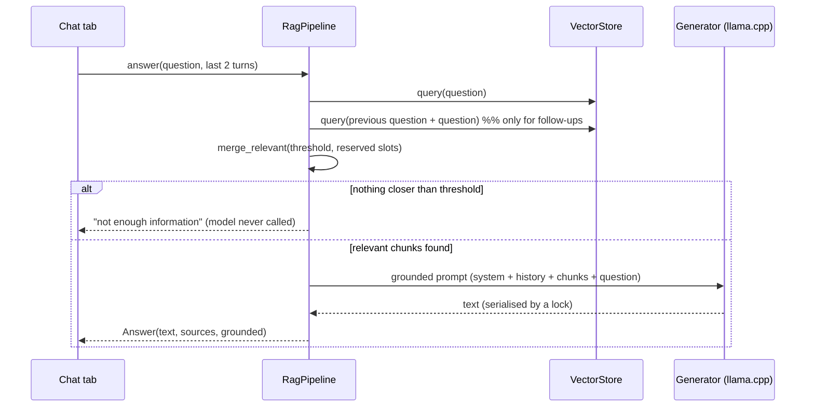

# Architecture

Suhail is a retrieval-augmented generation (RAG) system sized for a single organisation:
one server, one GPU, tens to low hundreds of documents, a few concurrent users. The design
goal is *boring and dependable* — the smallest architecture that is correct, testable and
operable — rather than a distributed one.

## Layers

```
┌──────────────────────────────────────────────────────────────┐
│ ui/            Streamlit tabs, theme, Arabic strings         │  presentation
├──────────────────────────────────────────────────────────────┤
│ rag/           pipeline · retrieval policy                   │  use cases
│ ingestion/     extract · rtl · chunking · service            │
├──────────────────────────────────────────────────────────────┤
│ knowledge/     vector store · registry · embeddings          │  infrastructure
│ llm/           prompts · llama.cpp generator                 │
├──────────────────────────────────────────────────────────────┤
│ config · security · models · errors                          │  foundations
└──────────────────────────────────────────────────────────────┘
        bootstrap.py = composition root (the only place that picks implementations)
```

Dependencies point downward only. The UI never touches Chroma or llama.cpp; the pipeline
depends on a vector store and a `Generator` protocol, not on concrete engines. That is what
lets the whole suite run with a fake embedder and fake LLM.

## Answering a question



Two properties matter here. First, **the model is only called when retrieval found
something relevant**; this is both the main hallucination guard and a latency saver.
Second, the answer carries structured **sources** (document and page), which the UI renders
as citations so staff can verify what they are told.

### Retrieval policy (`rag/retrieval.py`)

Follow-up questions such as "and what was the fine?" mean nothing alone, so the previous
question is prepended for a *second* search. The two result sets are merged, not
substituted, because prepending history to a single query can drag retrieval away from a
self-contained new question. A plain distance-sorted merge is not sufficient either: enough
history-flavoured chunks can crowd the new question's best match out of the top-k.
The merge therefore (1) discards chunks beyond the similarity threshold *first*, (2)
reserves half the slots for the plain question's best matches, (3) fills the rest by
distance. It is a pure function with tests that include a counter-example showing the naive
approach failing.

### Ingestion (`ingestion/`)

- **RTL repair** (`rtl.py`) — some PDF generators store Arabic as pre-shaped presentation
  forms in visual order, so extractors return mirrored words and letters. The repair
  reverses token order per Arabic-dominant line, reverses glyphs inside Arabic tokens
  *before* NFKC normalisation (so lam-alef ligatures expand in the right order), and
  mirrors brackets. It is a heuristic and is covered by round-trip tests built from a small
  shaper that produces realistic visual-order input.
- **Chunking** — a character window (350 / overlap 80) snapped to word boundaries rather than
  sentence splitting, because administrative Arabic is punctuation-light and sentence
  splitters produced oversized, diluted chunks. Chunks never start or end mid-word (the only exception is a single unbroken string with no whitespace at all).
- **DOCX** — blocks are read in document order, tables become `cell | cell` rows, merged
  cells are de-duplicated.

## Data and consistency

A document exists in three places: the **original file** (`data/uploads/<uuid>.<ext>`),
its **chunks** in Chroma, and a **registry record** (`data/doc_registry.json`).

| Operation | Guarantee |
|---|---|
| Ingest | All three are created, or none remain (chunks + file are rolled back on any failure) |
| Replace | New version is ingested *first*; the old one is deleted only on success |
| Edit manual text | Re-indexed by upsert + prune of stale chunks, never delete-then-add |
| Delete | Chunks, record and file removed together |
| Registry write | Temp file + `fsync` + atomic rename; a corrupt file raises rather than resetting |
| Re-index | Verifies every original exists *before* touching the index; refuses otherwise. Chroma pins the embedding model into the index, so opening it with a different model is refused with an explicit error until `reindex` rebuilds it |

Keeping the originals is deliberate: it is what makes `reindex` possible when the embedding
model or chunking changes.

## Concurrency

Streamlit runs each browser session in its own thread, while a `llama.cpp` model instance is
not safe for simultaneous calls. `LlamaCppGenerator` therefore serialises model loading
and inference with locks: concurrent employees queue rather than crash or interleave output.
For this scale that is the right trade-off; the upgrade path is a separate inference server
(see below).

## Key decisions

| Decision | Alternatives considered | Why |
|---|---|---|
| **Streamlit** UI | FastAPI + React | One deployable process, no build chain, easy for the client's IT to run. The use-case layer is UI-agnostic, so an API can be added without touching it |
| **Chroma** (embedded) | pgvector, Qdrant | Zero extra services; data fits easily in one process. `VectorStore` is the only class to change if this ever outgrows it |
| **llama.cpp in-process** | Ollama / vLLM server | Fewest moving parts on a locked-down server; GGUF quantisation fits a 14B model on a 12–16 GB GPU |
| **JSON registry** | SQLite | A few dozen records, human-inspectable, and atomic writes remove the main risk |
| **Dense retrieval** only | Hybrid BM25 + re-rank | Kept simple; listed as the first upgrade for exact identifiers |
| **systemd**, no Docker | Docker Compose | Target is a single on-prem host with GPU passthrough concerns; systemd + venv is the lowest-friction, most auditable option there |
| **Hash-only** admin password | Plaintext env var | A leaked `.env` does not reveal the password |
| **Metadata-only logs** | Log full Q&A | Questions on a government network may be sensitive |
| **Config in env, validated once** | Scattered `os.environ` | Typos fail at startup with a precise message instead of at 2 a.m. |

## Threat model and limits

In scope: casual or curious insiders, brute-forcing the admin password, malformed or
hostile uploads, accidental data loss, accidental data egress. Out of scope (documented
rather than hidden): TLS termination (use a reverse proxy), per-user identity and
document-level permissions, malicious-PDF parser exploits (run as an unprivileged user
with a read-only filesystem), prompt-injection through document *content* (mitigated only
by the grounding prompt).

## Scaling path

Single host → separate inference process (llama.cpp server or vLLM) behind the existing
`Generator` protocol → Postgres/pgvector behind `VectorStore` → hybrid search and a
re-ranker in `rag/retrieval.py`. Each step replaces one module without touching the rest.
